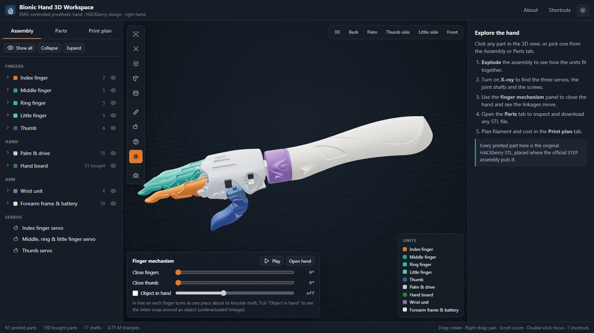
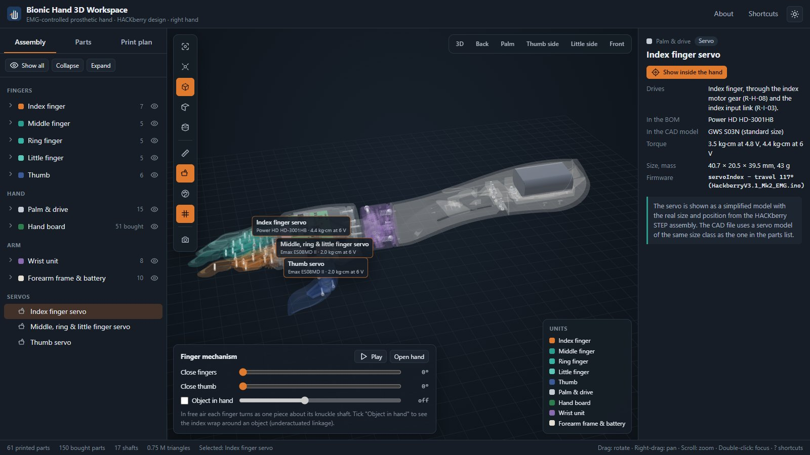
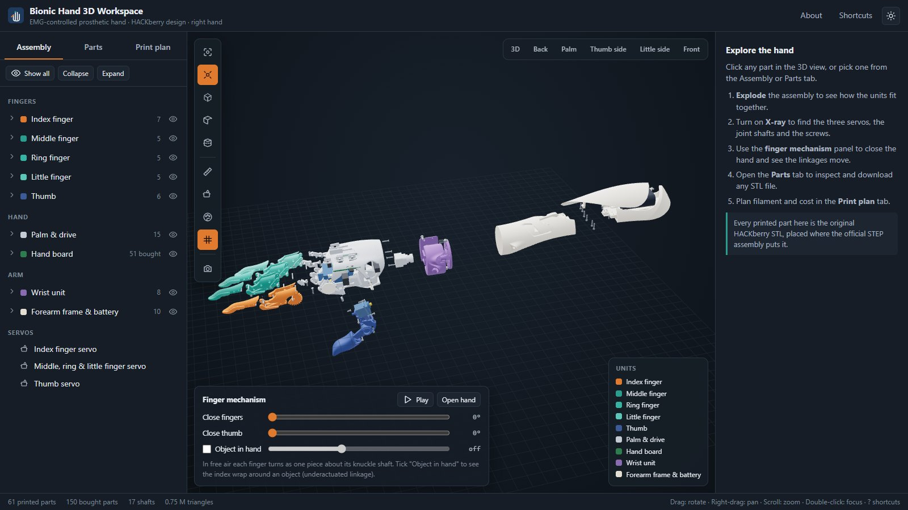
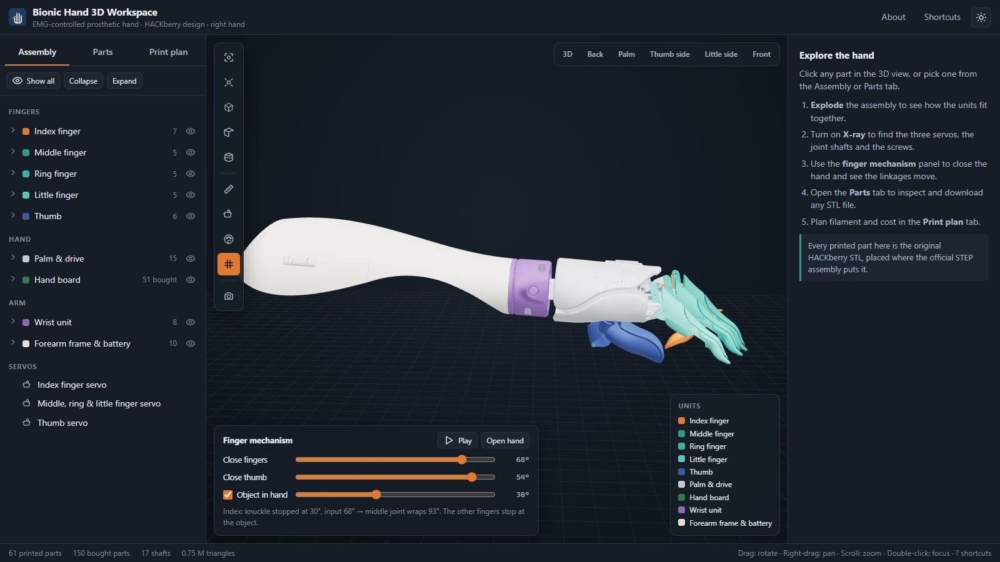
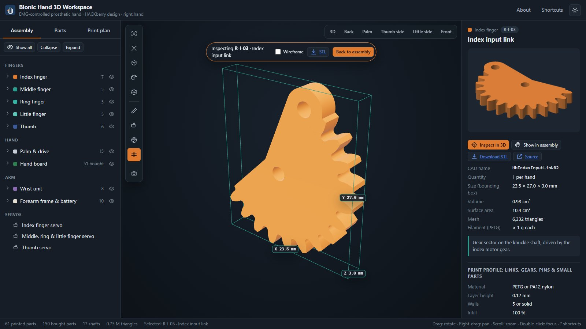
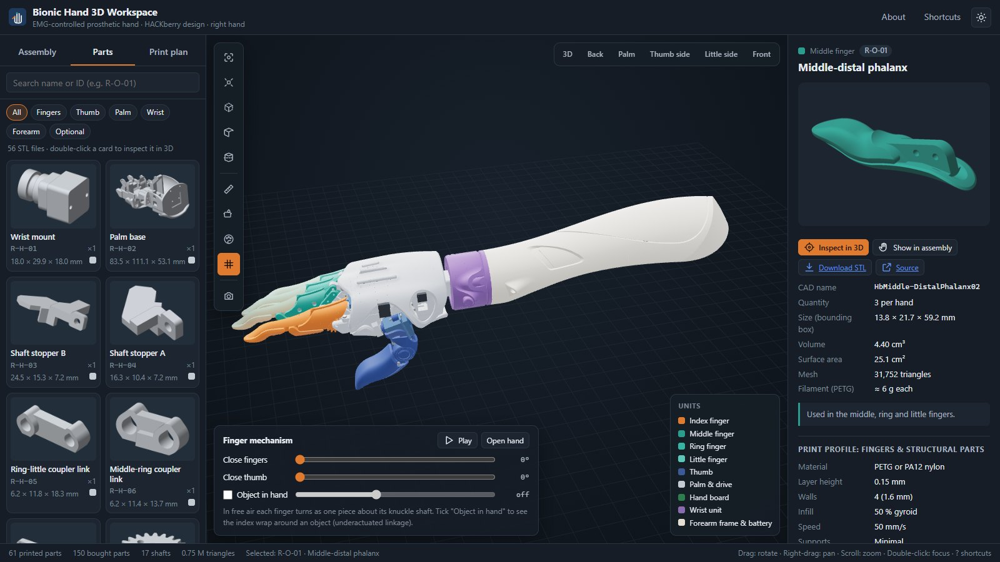
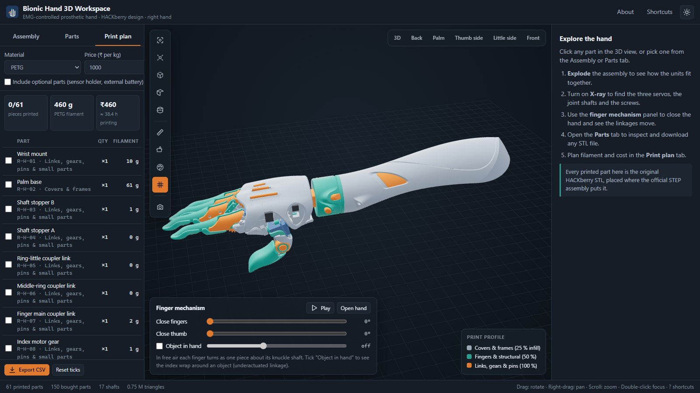

# Bionic Hand 3D Workspace

An interactive 3D workspace for an **EMG-controlled bionic hand for below-elbow amputees**, built on the
open-source **[HACKberry](https://github.com/mission-arm/HACKberry)** design. Explore the assembled hand,
open every printable STL part, see where the three servos sit, watch the finger linkages move, and plan
the 3D printing. Everything runs in the browser.



> **Live demo:** `https://<your-github-username>.github.io/<repository-name>/`
> (appears after the first deployment, see [Deploy to GitHub Pages](#deploy-to-github-pages))

---

## Features

| | |
| --- | --- |
| **Real assembly** | 61 printed-part instances placed exactly where the official HACKberry STEP assembly puts them, plus 150 bought parts and 17 steel joint shafts. |
| **Parts library** | All 56 STL print files with thumbnails, search and filters. Inspect any part on its own with a dimensioned bounding box, and download the STL. |
| **Servo layout** | The three servos in place, with labels, specs and what each one drives. Use X-ray to see them inside the hand. |
| **Finger mechanism** | Close the hand and the thumb with sliders. Tick "Object in hand" to see the index finger wrap around an object (underactuated four-bar linkage, solved live). |
| **Exploded view** | Units move apart, then parts spread within each unit, to show how it all goes together. |
| **Inspection tools** | Section plane, measuring tool, hide/isolate, three colour modes (units, print profile, printed plastic), six camera presets, screenshots. |
| **Print planner** | Checklist of every STL with filament weight, cost and print time for PLA+, PETG, PA12 or TPU. Progress is saved in the browser; export the plan as CSV. |
| **Shareable links** | URL parameters open the workspace in a given state (e.g. X-ray with servo labels). |
| **Light and dark themes** | The theme choice is remembered in your browser. |

| X-ray: servos inside the hand | Exploded view |
| --- | --- |
|  |  |
| **Finger mechanism with an object** | **Part inspection** |
|  |  |
| **Parts library** | **Print plan** |
|  |  |

---

## Quick start

**You need:** [Node.js](https://nodejs.org) 18 or newer (20 recommended) and Git.

```bash
git clone https://github.com/<your-github-username>/<repository-name>.git
cd <repository-name>
npm install        # installs three.js, Vite and Vitest
npm run dev        # starts http://localhost:5173 and opens it
```

> Opening `index.html` directly from the file system does **not** work: browsers block a page from
> loading local data files. Always use `npm run dev` (development) or `npm run preview` (built site).

### Scripts

| Command | What it does |
| --- | --- |
| `npm run dev` | Development server with hot reload. |
| `npm run build` | Production build into `dist/`. |
| `npm run preview` | Serves the `dist/` build locally to check it. |
| `npm test` | Runs the unit tests (kinematics, print estimates, CSV). |
| `npm run assets` | Regenerates `public/` from the HACKberry files (needs Python; see [scripts/README.md](scripts/README.md)). |

### Deploy to GitHub Pages

1. Push this repository to GitHub (branch `main`).
2. On GitHub open **Settings → Pages**, and under **Build and deployment** set **Source** to **GitHub Actions**.
3. Every push to `main` now runs [`.github/workflows/deploy.yml`](.github/workflows/deploy.yml), which installs,
   tests, builds and publishes the site. The address is shown in the workflow run and in **Settings → Pages**.

The build uses relative paths (`base: './'` in `vite.config.js`), so it works at any GitHub Pages address.

---

## Using the workspace

**Mouse:** left-drag to rotate, right-drag to pan, scroll to zoom, click to select, double-click to focus.

| Key | Action | Key | Action |
| --- | --- | --- | --- |
| `F` | Focus selection / fit all | `X` | X-ray |
| `H` | Hide selection | `S` | Section plane |
| `I` | Isolate selection | `M` | Measure |
| `A` | Show all | `L` | Servo labels |
| `E` | Explode / assemble | `C` | Cycle colour mode |
| `Space` | Play open-close animation | `P` | Screenshot |
| `1`–`6` | Camera views | `Esc` | Clear / exit tool |

### Shareable links

Add parameters to the address to open the workspace in a given state:

| Parameter | Example | Effect |
| --- | --- | --- |
| `view` | `view=3` | Camera: 0 3D, 1 back, 2 palm, 3 thumb side, 4 little-finger side, 5 front |
| `xray`, `inside`, `labels` | `xray=1&labels=1` | X-ray, hide covers, servo labels |
| `explode` | `explode=1` | Exploded view (0 to 1) |
| `color` | `color=print` | `unit`, `print` or `real` |
| `close`, `thumb` | `close=0.8&thumb=1` | Close the fingers / thumb (0 to 1) |
| `object` | `object=30` | An object stops the fingers at 30°; the index wraps |
| `part`, `servo` | `part=R-O-01` | Select a part or a servo (`servo-index`, `servo-fingers`, `servo-thumb`) |
| `inspect` | `inspect=R-H-08` | Open one part on its own |
| `tab` | `tab=print` | Left panel: `assembly`, `parts` or `print` |
| `section`, `cut` | `section=z&cut=0.5` | Section plane along x, y or z at 0 to 1 |
| `theme` | `theme=light` | `light` or `dark` |

Example: `…/?servo=servo-index&xray=1&labels=1` shows the servo layout inside the hand.

---

## How the hand works

Verified from the HACKberry CAD assembly and firmware:

| Servo | Model (BOM) | Drives |
| --- | --- | --- |
| Index finger servo | Standard size, Power HD HD-3001HB (4.4 kg·cm at 6 V) | Index finger, through the printed gear pair: motor gear R-H-08 → input link R-I-03 |
| Middle, ring & little servo | Micro, Emax ES08MD II (2.0 kg·cm at 6 V) | The three fingers together, through the finger main coupler link R-H-07 and links R-H-06, R-H-05 |
| Thumb servo | Micro, Emax ES08MD II (2.0 kg·cm at 6 V) | Thumb proximal phalanx; a button switches it open or closed |

Each finger is an **underactuated linkage**: the proximal phalanx and the input crank turn on the same
knuckle (MCP) shaft, and a coupler link joins the input to the middle-distal phalanx. In free air the
finger closes as one piece. When the proximal phalanx touches an object, the coupler keeps pushing and the
fingertip wraps around it. The middle and distal phalanges are one printed part, so the DIP joint is fixed.
All joints turn on 2 mm steel shafts.

## How the website works

1. **Offline data pipeline (Python, `scripts/`)**: reads the HACKberry STEP assembly without a CAD kernel,
   gets the position of every part, finds each finger's joint shafts, measures every STL (volume, area, size),
   renders thumbnails and writes one JSON file. The STL files were exported in the same coordinates as their
   STEP parts, so the real print files can be assembled exactly.
2. **Browser runtime (JavaScript, `src/`)**: loads the JSON and the STL files, builds a three.js mesh for every
   part instance, draws simplified models for the bought parts, and recomputes each mesh as
   `explode × motion × placement` when you explode or move the hand. Finger motion is solved live by the
   four-bar code in `src/lib/kinematics.js`.

Details: [docs/ARCHITECTURE.md](docs/ARCHITECTURE.md) (code and maths) and [scripts/README.md](scripts/README.md) (pipeline).

## Project structure

```
├── index.html                  App shell: panels, viewport, dialogs
├── package.json                Scripts and dependencies (three.js, Vite, Vitest)
├── vite.config.js              Build config (relative paths for GitHub Pages)
├── public/                     Static files, served as they are
│   ├── data/hackberry-right.json   Parts, placements, servos, finger rigs (generated)
│   ├── models/parts/*.stl          56 printable STL files (HACKberry, CC BY-NC-SA 4.0)
│   ├── thumbnails/*.png            Part thumbnails (generated)
│   └── favicon.svg
├── src/
│   ├── main.js                 Entry point: styles + App
│   ├── app/App.js              State, selection, tools, keyboard, pointer, URL parameters
│   ├── viewer/Viewer.js        Renderer, camera, controls, lights, picking, screenshots
│   ├── model/                  HandModel (assembly, explode, pose, colours) and HardwareFactory
│   ├── features/               Section plane, measure tool, servo labels, part inspection
│   ├── ui/                     Assembly tree, parts library, inspector, print plan, toolbar, …
│   ├── lib/                    Pure logic: kinematics, print estimates, CSV, formatting
│   └── styles/                 Theme tokens, layout and component styles
├── tests/                      Unit tests (Vitest)
├── scripts/                    Python asset pipeline (STEP reader, STL tools, rigs, thumbnails)
├── docs/
│   ├── ARCHITECTURE.md         How the code and the pipeline work
│   ├── presentation/           UGP presentation (PDF) and its figures
│   └── screenshots/            Images used in this README
└── .github/workflows/          GitHub Pages deployment
```

## Tech stack

[three.js](https://threejs.org) 0.170 (3D rendering) · [Vite](https://vitejs.dev) 5 (dev server and build) ·
[Vitest](https://vitest.dev) (tests) · plain JavaScript modules and CSS, no UI framework · Python with
numpy and Pillow for the data pipeline.

## About the project

UG Project (UGP), School of Biomedical Engineering, Indian Institute of Technology (BHU) Varanasi.
Student: Mohit. Guide: Dr. Shiru Sharma. The EMG electronics are part of the project; this repository is the
3D workspace for the mechanical hand. The project presentation is in
[docs/presentation](docs/presentation/).

## Credits and licences

* **HACKberry 3D models** © exiii Inc., [CC BY-NC-SA 4.0](https://creativecommons.org/licenses/by-nc-sa/4.0/),
  from [github.com/mission-arm/HACKberry](https://github.com/mission-arm/HACKberry). Non-commercial use only.
  See [LICENSE-MODELS.md](LICENSE-MODELS.md) for what was changed.
* **Website code** (src, scripts, tests): [MIT](LICENSE).
* three.js and Vite are MIT-licensed.

This project is not affiliated with exiii Inc. It is an educational project and not a medical device.
