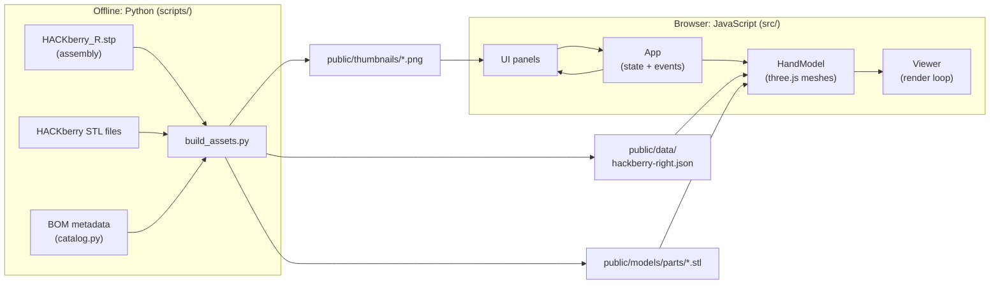

# Architecture

This document explains how the Bionic Hand 3D Workspace is put together, for anyone who wants to
change or extend it.

## 1. Big picture



The heavy work (reading the CAD assembly, finding joints, measuring parts) happens once, offline.
The browser only loads a small JSON file plus the STL files and assembles them.

## 2. Folder by folder

| Folder | Responsibility | Depends on |
| --- | --- | --- |
| `src/lib/` | Pure functions: finger kinematics, print estimates, CSV, formatting, storage, event emitter. No DOM, no three.js, so they are unit-tested in Node. | nothing |
| `src/viewer/` | `Viewer`: WebGL renderer, camera, OrbitControls, lights, HTML label renderer, camera fly-to, picking, screenshots. | three.js |
| `src/model/` | `HandModel`: builds one mesh per part instance, bought part and shaft; applies explode, mechanism pose, colours, visibility, clipping. `HardwareFactory`: simplified servo/screw/spring/battery geometry. | three.js, `lib/` |
| `src/features/` | Tools on top of the viewer: section plane, measure tool, servo labels, single-part inspection. | three.js |
| `src/ui/` | DOM panels: assembly tree, parts library, inspector, print planner, toolbar, view bar, legend, mechanism panel, status bar, dialogs. | `app` API only |
| `src/app/` | `App`: owns the state, wires features and panels, handles the keyboard, pointer and URL parameters. | everything |
| `scripts/` | Python pipeline that writes `public/`. | numpy, Pillow |
| `tests/` | Vitest tests for `src/lib/`, using the real generated data. | Vitest |

The UI never touches three.js directly: it calls `App` methods (`select`, `toggle`, `setPose`,
`inspectPart`, …) and listens to the app's event bus:

| Event | When | Typical listener |
| --- | --- | --- |
| `selection` | the selected part/unit/servo changed | inspector, tree, library, status bar |
| `state` | a tool or display setting changed | toolbar, legend |
| `visibility` | parts were hidden or shown | assembly tree eyes |
| `pose` | the mechanism moved (payload: angles) | mechanism panel |

## 3. Coordinates and transforms

* **Data frame**: millimetres, the coordinate system of the HACKberry STEP assembly.
* **Root group**: `HandModel` rotates the data frame so the fingers point along **+X**, the back of the hand
  faces **+Y** and the thumb side is **−Z**, then centres the model on the floor grid.
* **Every mesh** has `matrixAutoUpdate = false` and is rebuilt from three pieces:

```
mesh.matrix = explodeOffset × rigMotion × base
```

| Piece | Source |
| --- | --- |
| `base` | the part's placement in the STEP assembly (`instances[].matrix`, column-major) |
| `rigMotion` | finger, thumb and gear motion from `lib/kinematics.js` (identity when the hand is open) |
| `explodeOffset` | `t × (0.9 × (unitCentre − palmCentre) + 0.55 × (partCentre − unitCentre))` |

## 4. Finger mechanism (underactuated linkage)

Each finger rig (from `rigs.py`) has four pivots on parallel 2 mm shafts:

```
        input pin I ●──────── coupler ────────● distal pin D
                     \                         \
   MCP ●──(input crank)       proximal phalanx  ● PIP ── middle-distal phalanx ──▶ tip
```

* The input (index: gear sector R-I-03) turns about the **MCP** shaft by angle **α**.
* The proximal phalanx turns about the same shaft by **β**. In free air **β = α** and everything turns
  together.
* If an object stops the proximal phalanx (**β < α**), the coupler length |I − D| must stay constant, so
  the middle-distal phalanx turns about the **PIP** by an extra angle **δ**. `solveFinger()` finds δ with a
  bracketed root search, staying on the branch closest to the previous frame.
* The coupler body is then placed by rotating it about I and translating I to its new position.

Only the index finger has its input crank on the MCP shaft, so only the index wraps. The other three
fingers are driven by a chain of links in the palm; the demo moves them as one piece and stops them at
the object. The index motor gear turns the opposite way with ratio ≈ 1.03 (external gear pair).

## 5. Adding things

* **A new tool button**: add an icon to `ui/icons.js`, an entry in `Toolbar.render()`, and a case in
  `App.toggle()`.
* **A new panel**: create `ui/MyPanel.js` with `constructor(app, host)`, give it a host element in
  `index.html` and instantiate it in `App.start()`. Listen to `app.bus` for updates.
* **Another hand**: the pipeline is data-driven. Add the left-hand STEP/STL paths in `catalog.py`,
  write `hackberry-left.json`, and pass the file name to `HandModel.load()`.
* **Better bought-part models**: `HardwareFactory.buildHardware(spec)` switches on `spec.kind`; add a
  kind and describe it in `catalog.HARDWARE`.

## 6. Performance notes

* About 0.76 M triangles are drawn; each STL is loaded once and shared by its instances (the three
  identical fingers reuse the same geometries).
* STL normals are rebuilt with `toCreasedNormals` (32°) for smooth surfaces with crisp CAD edges.
* Hover picking is throttled to ~9 Hz and disabled while dragging.
* The 79 MB back cover is decimated to 66 k triangles for display.
